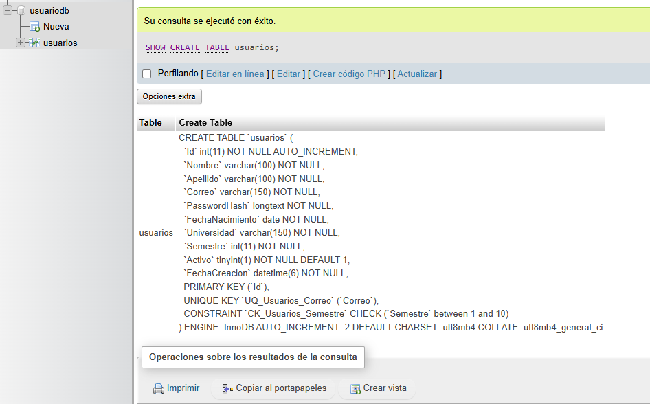
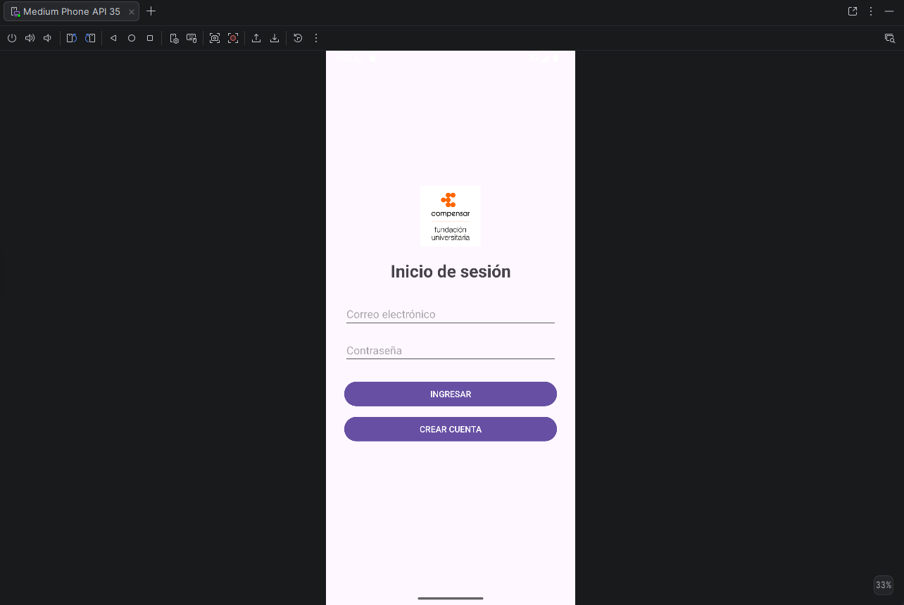
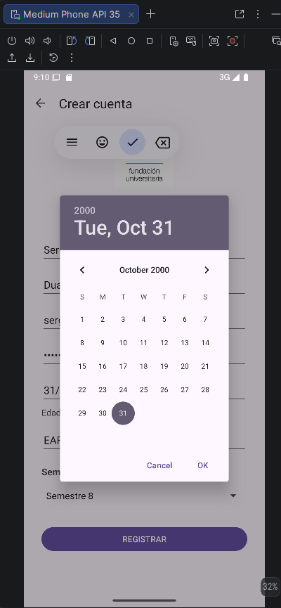
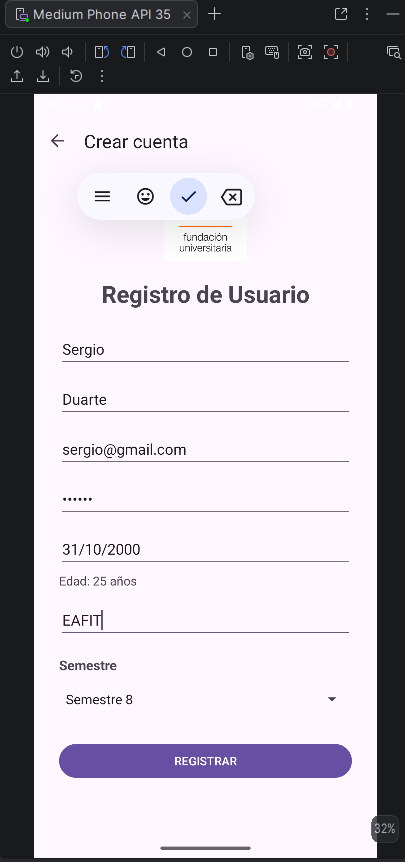
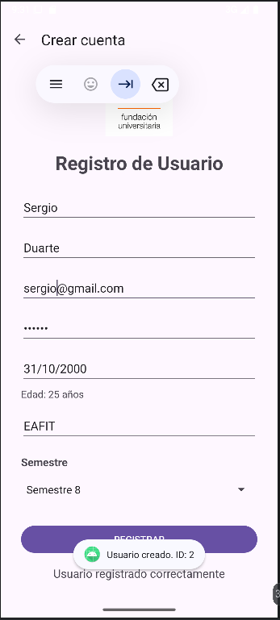
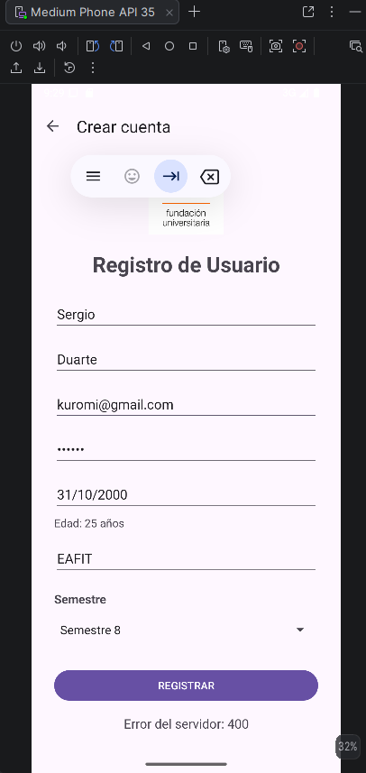
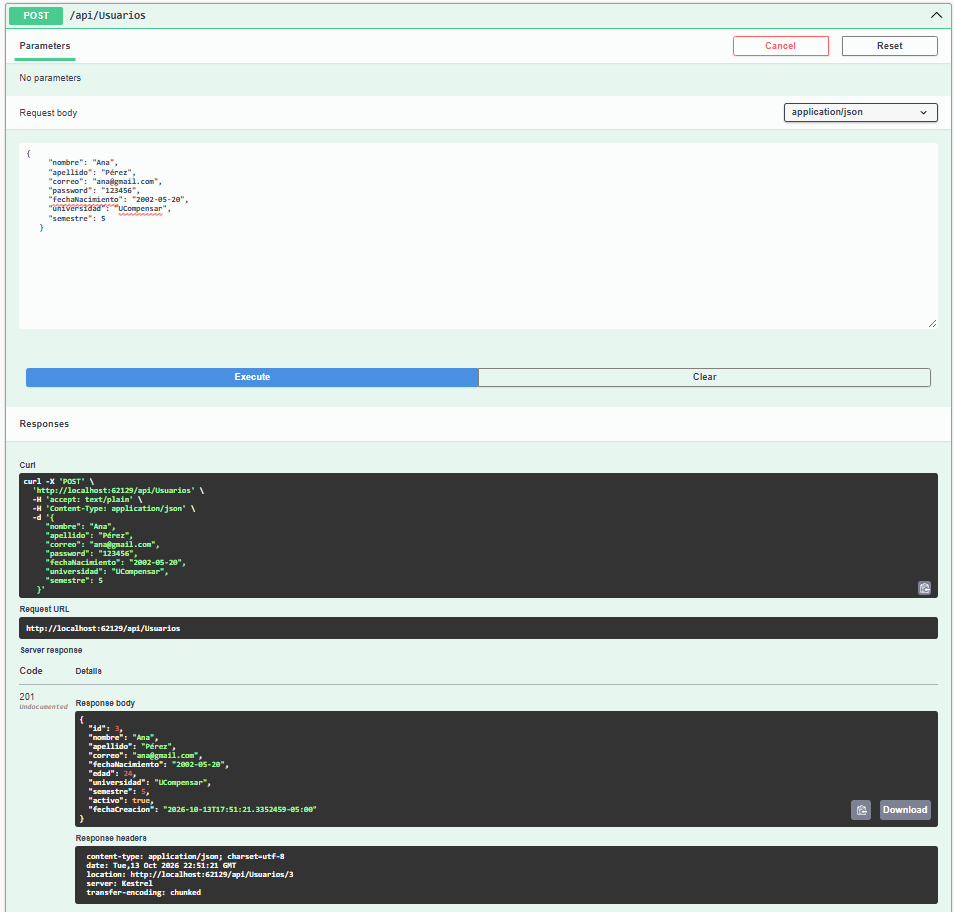

# UserManagement - Android (Kotlin) + API .NET

Proyecto académico: aplicación Android en Kotlin que consume una API REST en .NET para la gestión de usuarios.

- **Estudiante:** _Steffanny Katherine Torres Conde y Stefanie Geraldine Gallo Becerra_
- **Asignatura:** _Nombre de la asignatura_
- **Docente:** _Flavio Alexander Navarro Carmona_
- **Repositorio Android:** _https://github.com/Aguakathe/UserManagement-Android-Kotlin.git_
- **Repositorio API .NET:** _https://github.com/Aguakathe/UserManagement-API-DotNet_

---

## Cómo ejecutar el proyecto

1. Ejecutar los scripts de `Database/` en MySQL (`01_crear_tabla_usuarios.sql` y `02_actualizar_tabla_usuarios.sql`).
2. Iniciar la API: `dotnet run` (escucha en `http://0.0.0.0:62129`).
3. Abrir el proyecto Android en Android Studio y ejecutarlo en el emulador (usa `http://10.0.2.2:62129/` para llegar a la API).

---

## Evidencias y entregables

### 1. Proyecto Android modificado y funcional
- **Registro (4.1):** se eliminaron los campos *Rol* y *Edad* y el botón "Volver al login". Se agregó una
  barra superior con flecha de regreso, el campo *Fecha de nacimiento* (abre un `DatePickerDialog` que no
  permite fechas futuras), la edad calculada automáticamente, el campo *Universidad* y un Spinner de
  *Semestre* (1 a 10). Se añadieron validaciones en todos los campos.
- **Utilidades:** nueva clase `FechaUtils` (cálculo de edad por día, mes y año, y formato `yyyy-MM-dd`
  para enviar a la API) con pruebas unitarias en `FechaUtilsTest`.
- **Modelos:** `CrearUsuarioRequest` y `Usuario` sincronizados con la API.
- **Registro exitoso (4.2):** AlertDialog "Registro exitoso" que regresa al Login.
- **Errores de la API (4.3):** nueva clase `ApiErrorParser` que lee el mensaje de error del backend y lo
  muestra en Registro y Login.

### 2. API .NET modificada y funcional
- `Usuario`: se eliminaron `Edad` y `RolId`; se agregaron `FechaNacimiento` (`DateOnly`), `Universidad`
  y `Semestre`.
- `CrearUsuarioDto` y `ActualizarUsuarioDto`: nuevos campos con validaciones (`[Required]` y
  `[Range(1,10)]` para el semestre).
- `UsuarioDto` (respuesta): incluye `fechaNacimiento`, `universidad`, `semestre` y la `edad` calculada.
  No expone la contraseña ni el hash.
- `UsuarioService`: métodos `CalcularEdad` y `ValidarFechaNacimiento` (rechaza fechas futuras).
  Se mantienen la validación de correo duplicado y el cifrado con BCrypt.
- `ApplicationDbContext`: configuración de las columnas nuevas y restricción de semestre entre 1 y 10.

### 3. Cambios realizados en la base de datos
Scripts en la carpeta `Database/`:
- `01_crear_tabla_usuarios.sql`: crea la tabla desde cero.
- `02_actualizar_tabla_usuarios.sql`: agrega `FechaNacimiento`, `Universidad` y `Semestre`, calcula una
  fecha aproximada para los usuarios existentes y elimina `Edad` y `RolId`. Termina con
  `DESCRIBE Usuarios;`, cuyo resultado se muestra en la captura.

### 4. Nueva pantalla de Registro

### 5. DatePicker para la fecha de nacimiento
* **Vista del componente:**

* **Vista del selector de fecha desplegado:**

### 6. Registro exitoso y AlertDialog

### 7. Manejo de correo duplicado

### 8. Pantalla principal con saludo personalizado

PENDIENTE

### 9. AlertDialog de confirmación de cierre de sesión

PENDIENTE

### 10. Pantalla Par o Impar con la nueva navegación superior

PENDIENTE

### 11. Servicios modificados en Swagger

### 12. Código fuente
Entregado mediante: _GitHub / ZIP / plataforma indicada por el docente_ (enlace).